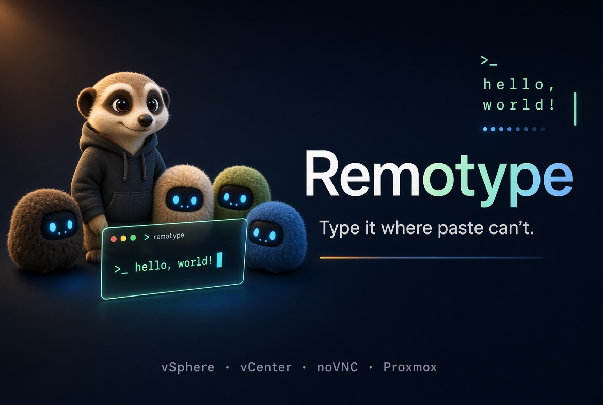

<p align="center">
  
</p>

# Remotype (ریموتایپ)

**آن‌جا که paste کار نمی‌کند، تایپ کن.** یک افزونه کوچک کروم که متن را **کلید به کلید** در کنسول‌های وب راه‌دور تایپ می‌کند: کنسول وب VMware vSphere و vCenter، noVNC (Proxmox و مشابه) و دیگر کنسول‌های مبتنی بر canvas که Ctrl+V در آن‌ها اثری ندارد.

[English](README.md) · [راهنمای استفاده](docs/usage.fa.md) · [سازگاری](docs/compatibility.md) · [عیب‌یابی](docs/troubleshooting.fa.md) · [تاریخچه تغییرات](CHANGELOG.md)

## مشکل

کنسول‌های وب کلیپ‌بورد مرورگر را با ماشین راه‌دور به اشتراک نمی‌گذارند و فقط ورودی صفحه‌کلید را می‌پذیرند. پس نمی‌شود یک دستور طولانی، توکن یا خط پیکربندی را در کنسول ماشین مجازی paste کرد و تایپ دستی هم کند و پرخطاست.

راه‌حل‌های معمول همیشه جواب نمی‌دهند:

- **vSphere:** طبق گزارش‌های تالارها، copy/paste در VM Remote Console کامل کار می‌کند اما در کنسول وب نه، حتی بعد از تنظیم `isolation.tools.copy.disable` و `isolation.tools.paste.disable` روی `FALSE`؛ و تغییر به راه‌اندازی مجدد ماشین نیاز دارد. بسیاری از سازمان‌ها paste کنسول را عمداً به‌عنوان سخت‌سازی امنیتی غیرفعال می‌کنند.
- **Proxmox و noVNC:** کلیپ‌بورد به یک guest agent (مثل `spice-agent`) نیاز دارد و برای ماشین مجازی «متن» و «کلید» دو چیز متفاوت‌اند.
- **AutoHotkey و Tampermonkey:** کار می‌کنند ولی برای هر ماشین تنظیم می‌خواهند و با به‌روزرسانی مرورگر خراب می‌شوند.

## Remotype چه می‌کند

داخل کنسول کلیک می‌کنی، متن را در Remotype می‌چسبانی و **Type** را می‌زنی. Remotype هر کاراکتر را مثل فشردن واقعی کلید می‌فرستد (با Shift و AltGr در صورت نیاز چیدمان)، پس کنسول آن را عین تایپ‌کردن می‌بیند.

## امکانات

- تایپ دستور، توکن و اسکریپت چندخطی در کنسولِ فوکوس‌شده
- پاپ‌آپ **یا پنل کناری**؛ پنل کناری با کلیک روی کنسول بسته نمی‌شود
- چیدمان‌ها: **US**، UK، آلمانی و فرانسوی (UK و آلمانی و فرانسوی آزمایشی‌اند)
- تأخیر بین کلیدها، مکث بعد از Enter و تأخیر شروع قابل تنظیم
- نشان پیشرفت روی آیکن و دکمه **Stop**
- قطعه‌های ذخیره‌شده با تایپ یک‌کلیکی
- رابط فارسی و انگلیسی
- **بدون دسترسی به شبکه، بدون آمار، بدون مجوز دسترسی به سایت‌ها.** متنی که تایپ می‌کنی ذخیره نمی‌شود؛ فقط قطعه‌هایی که خودت ذخیره کنی به‌صورت محلی می‌مانند

## استفاده با دستیارهای هوش مصنوعی

دستیارها و ایجنت‌های مرورگر معمولاً جلوی کنسول راه‌دور گیر می‌کنند. کنسول یک canvas است و متنی برای خواندن یا پر کردن در صفحه ندارد، کلیپ‌بوردی برای paste نیست، و بسیاری از ایجنت‌ها عمداً طوری طراحی شده‌اند که با رمز عبور کار نکنند. نتیجه معمول: دستیار یک دستور یا پیکربندی طولانی آماده می‌کند و تو باید آن را دستی دوباره تایپ کنی.

Remotype راه‌حلِ «انسان در حلقه» برای کنسول‌هایی مثل کنسول وب VMware vSphere و vCenter، noVNC و Proxmox است: بگذار دستیار متن را آماده کند، خودت بخوانی‌اش، در Remotype بچسبانی و **Type** را بزنی. رمز عبور لازم نیست از دست دستیار رد شود. Remotype ایجنت نیست: صفحه را نمی‌خواند، API ندارد و تا «Type» را نزنی کاری نمی‌کند.

## نصب

از سورس (همین حالا کار می‌کند):

1. این مخزن را دانلود یا clone کن.
2. `chrome://extensions` را باز کن و **Developer mode** را روشن کن.
3. **Load unpacked** را بزن و همین پوشه را انتخاب کن.
4. آیکن را سنجاق کن. میانبرها: `Alt+Shift+K` پاپ‌آپ، `Alt+Shift+L` پنل کناری.

نیاز به کروم یا مرورگر Chromium نسخه ۱۱۶ به بالا.

## استفاده

1. داخل کنسول کلیک کن تا فوکوس صفحه‌کلید داشته باشد.
2. Remotype را باز کن، متن را بچسبان، چیدمان **ماشین مقصد** را انتخاب کن و **Type** (یا Ctrl+Enter) را بزن.

چیدمانی که انتخاب می‌کنی باید با چیدمان تنظیم‌شده داخل ماشین راه‌دور یکی باشد. در کنسول وب vSphere دکمه **Enforce US Keyboard Layout** چیدمان را روی US می‌گذارد.

راهنمای کامل (پاپ‌آپ در برابر پنل کناری، قطعه‌ها، تنظیمات، نشست): [docs/usage.fa.md](docs/usage.fa.md)، به انگلیسی هم [docs/usage.md](docs/usage.md).

## چیدمان‌ها

| چیدمان | وضعیت |
|---|---|
| US (QWERTY) | پیش‌فرض. تأییدشده توسط نویسنده در کنسول وب vCenter (ببین [سازگاری](docs/compatibility.md)) |
| UK، آلمانی (QWERTZ)، فرانسوی (AZERTY) | آزمایشی. کاراکترهای AltGr به نحوه ترجمه کلید در کنسول بستگی دارند |

کلیدهای مرده (مثل `^` و `´` در آلمانی، `^` و `¨` در فرانسوی) پشتیبانی نمی‌شوند. کاراکترهایی که روی چیدمان انتخابی نیستند در هشدار می‌آیند و رد می‌شوند. متن فارسی و دیگر الفباهای غیرلاتین قابل تایپ نیست.

## چطور کار می‌کند

Remotype دیباگر کروم را فقط به **تب فعال** وصل می‌کند و برای هر کلید رویداد `Input.dispatchKeyEvent` می‌فرستد.

- **پاپ‌آپ:** برای یک تایپ وصل می‌شود و با پایان کار جدا می‌شود.
- **پنل کناری (رفتار پیش‌فرض):** با اولین «Type» وصل می‌شود و وصل می‌ماند، تا با هر دستور صفحه بالا و پایین نپرد. پنل یک ردیف سبز «Connected» با دکمه **Disconnect** نشان می‌دهد. اتصال قطع می‌شود وقتی Disconnect را بزنی، پنل را ببندی، روی Cancel نوار کروم بزنی، یا بعد از زمان بیکاری (پیش‌فرض ۱۵ دقیقه، قابل تنظیم). با گزینه «تا وقتی این پنل باز است وصل بمان» در تنظیمات پنل می‌توانی این رفتار را خاموش کنی تا پنل مثل پاپ‌آپ کار کند.

کروم تا وقتی دیباگر وصل است نوار «started debugging this browser» را نشان می‌دهد که طبیعی است. content script و مجوز دسترسی به سایت‌ها وجود ندارد، پس تا «Type» را نزنی Remotype روی هیچ صفحه‌ای کاری نمی‌تواند بکند.

## مقایسه با ابزارهای دیگر

افزونه‌های دیگری هم همین مشکل را برای کنسول‌های مشخص حل می‌کنند. این جدول فقط واقعیت‌های لیست عمومی آن‌ها را آورده (جزئیات و منابع در [docs/competitor-notes.md](docs/competitor-notes.md)).

| | Remotype | Paste to vSphere VM | KVM Console Paste | PVE Snippets |
|---|---|---|---|---|
| هدف اصلی | vSphere، noVNC، کنسول‌های canvas | vSphere | noVNC (Proxmox، IONOS، Plesk) | noVNC در Proxmox |
| چیدمان‌ها | US، UK، DE، FR (۳ آزمایشی) | مستند نشده | مستند نشده | ۱۱ چیدمان با کلید مرده |
| قطعه‌های ذخیره‌شده | بله | مستند نشده | مستند نشده | بله (تا ۲۰۰) |
| توقف و پیشرفت | بله | مستند نشده | بله | مستند نشده |
| متن‌باز | بله (MIT) | مستند نشده | مستند نشده | مستند نشده |

Remotype جدیدتر است و به اندازه این‌ها آزموده نشده. اگر یکی از آن‌ها برای کنسول تو کار می‌کند، از همان استفاده کن.

## پرسش‌های متداول

**چرا Ctrl+V در کنسول وب vSphere کار نمی‌کند؟**
کنسول یک نمایشگر راه‌دور است که فقط رویدادهای صفحه‌کلید را می‌فرستد. کلیپ‌بورد مرورگر به اشتراک گذاشته نمی‌شود مگر VMware Tools و تنظیمات خاص ماشین اجازه بدهند، که اغلب با سیاست امنیتی بسته است.

**روی Proxmox، noVNC، IONOS و Plesk کار می‌کند؟**
رویدادهای استاندارد صفحه‌کلید می‌فرستد پس باید کار کند، ولی فقط کنسول وب vCenter تأیید شده. گزارش‌ها خوشایندند؛ ببین [سازگاری](docs/compatibility.md).

**امن است؟ چرا مجوز debugger می‌خواهد؟**
فرستادن رویداد واقعی صفحه‌کلید به canvas به API دیباگر کروم نیاز دارد. Remotype فقط به تب فعال وصل می‌شود (در پاپ‌آپ هنگام تایپ، و در پنل کناری تا وقتی نشست وصل است)، مجوز سایت ندارد، درخواست شبکه نمی‌فرستد و کدش به‌اندازه‌ای کوتاه است که در یک نشست خوانده شود. ببین [SECURITY.md](SECURITY.md).

**چرا کروم «started debugging this browser» نشان می‌دهد؟**
این اعلان داخلی کروم است وقتی افزونه از دیباگر استفاده می‌کند. در پاپ‌آپ با پایان تایپ برمی‌گردد. در پنل کناری تا وقتی نشست وصل است می‌ماند (برای پایان‌دادن Disconnect را بزن یا پنل را ببند).

**می‌شود فارسی، عربی یا الفبای دیگر تایپ کرد؟**
نه. Remotype کلیدهای فیزیکی چیدمان لاتین انتخابی را می‌فرستد، پس فقط کاراکترهای همان چیدمان.

**دستیار هوش مصنوعی‌ام نمی‌تواند در کنسول ماشین مجازی paste یا تایپ کند. چه کنم؟**
از دستیار بخواه متن را به تو بدهد، سپس خودت آن را در Remotype بچسبان و Type را بزن. کنترل دست توست و رمز عبور از دست دستیار دور می‌ماند. Remotype برای دور زدن قواعد ایمنی دستیارها ساخته نشده و بدون زدن Type هیچ کاری نمی‌کند.

**در فایرفاکس کار می‌کند؟**
نه. از API دیباگر کروم استفاده می‌کند.

**رمز عبور را هم تایپ می‌کند؟**
هر چه بدهی تایپ می‌کند. چیزی که تایپ می‌کنی ذخیره نمی‌شود. رمز را به‌عنوان قطعه ذخیره نکن.

**می‌تواند سیاست «ممنوعیت paste» شرکت را دور بزند؟**
از نظر فنی متن را مثل یک آدم تایپ می‌کند. اگر paste عمداً بسته است، مطمئن شو استفاده از Remotype در محیطت مجاز است.

## محدودیت‌ها

- متن خیلی طولانی زمان می‌برد، چون کلید به کلید تایپ می‌شود. اگر کلیدی گم شد، تأخیر را بیشتر کن.
- اگر DevTools روی همان تب باز باشد، دیباگر وصل نمی‌شود.
- روی همه کنسول‌ها و نسخه‌های کروم آزمایش نشده.

## مشارکت

گزارش باگ، گزارش سازگاری کنسول‌ها و چیدمان‌های جدید خوشایندند. ببین [CONTRIBUTING.md](CONTRIBUTING.md). بررسی‌ها را با این دستور اجرا کن:

```
node test-keymap.mjs
```

## مجوز

[MIT](LICENSE)
