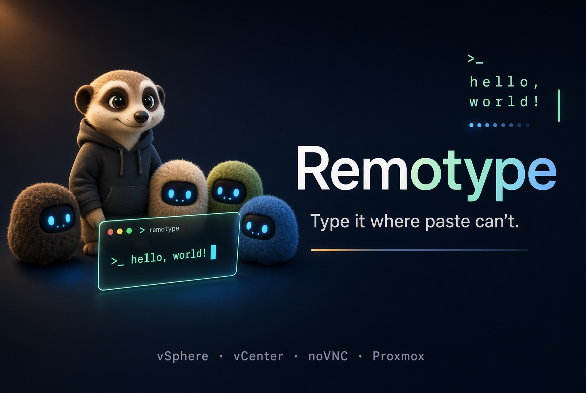

<p align="center">
  
</p>

# Remotype

**Type it where paste can't.** A small Chrome extension that types your text **as keystrokes**, key by key, into remote web consoles where copy and paste does not work: the VMware vSphere / vCenter web console, noVNC (Proxmox and similar) and other canvas-based VM consoles. Other keyboard-only web consoles (iDRAC, iLO, IPMI / KVM-over-IP) may work too but are untested.

[فارسی](README.fa.md) · [Usage guide](docs/usage.md) · [Compatibility](docs/compatibility.md) · [Troubleshooting](docs/troubleshooting.md) · [Changelog](CHANGELOG.md)

[](https://github.com/hamooll/remotype/releases/latest)


## The problem

Web consoles do not share your browser clipboard with the remote machine. They accept keyboard input only, so you cannot paste a long command, a token or a config line into a VM console, and typing it by hand is slow and error-prone.

The usual fixes do not always work:

- **vSphere:** forum threads report that copy/paste works in the full VM Remote Console but not in the web console, even after setting `isolation.tools.copy.disable` and `isolation.tools.paste.disable` to `FALSE`, and the change needs a VM restart. Many organisations disable console paste on purpose as a hardening measure.
- **Proxmox / noVNC:** the clipboard needs a guest agent (for example `spice-agent`), and "text" and "keystrokes" are different things to a virtual machine.
- **AutoHotkey / Tampermonkey scripts:** work, but need per-machine setup and break with browser updates.

## What Remotype does

You click inside the console, paste your text into Remotype and press **Type**. Remotype then sends every character as a real key press (including Shift and AltGr where your layout needs them), so the console treats it exactly like typing.

## Features

- Types commands, tokens and multi-line scripts into the focused console
- Popup **or side panel**; the side panel stays open and connected while you click around the console and run many commands
- Keyboard layouts: **US**, UK, German, French (UK, German and French are experimental)
- Adjustable delay between keys, pause after Enter and start delay
- Progress badge on the toolbar icon and a **Stop** button
- Saved snippets with one-click typing
- English and Persian interface
- **No network access, no analytics, no host permissions.** Text you type is never stored; only snippets you save are kept locally

## Using Remotype with AI assistants

AI assistants and browser agents often get stuck at a remote console. The console is a canvas with no page text to read or fill in, there is no clipboard to paste from, and many agents are deliberately designed not to handle passwords. The usual result: the assistant prepares a long command or config and you have to retype it by hand.

Remotype is the human-in-the-loop answer for consoles such as the VMware vSphere / vCenter web console, noVNC and Proxmox: let the assistant prepare the text, read it yourself, paste it into Remotype and press **Type**. Secrets never have to pass through the assistant. Remotype is not an agent: it does not read the page, has no API, and does nothing until you press Type.

## Install

Remotype is not on the Chrome Web Store yet, so you install it as an unpacked extension (about a minute):

1. **Download** the latest `remotype-vX.Y.Z.zip` from the [Releases page](https://github.com/hamooll/remotype/releases/latest) and **unzip it** into a folder you will keep. Chrome runs the extension from that folder, so do not delete or move it afterwards. (Or clone this repository.)
2. Open `chrome://extensions` and turn on **Developer mode**.
3. Click **Load unpacked** and choose the unzipped folder.
4. Pin the icon. Shortcuts: `Alt+Shift+K` opens the popup, `Alt+Shift+L` opens the side panel.

Requires Chrome or a Chromium-based browser, version 116 or newer.

## Use

1. Click inside the console so it has keyboard focus.
2. Open Remotype, paste the text, choose the layout of the **target machine** and press **Type** (or Ctrl+Enter).

The layout you choose must match the layout configured inside the remote machine. In the vSphere web console the **Enforce US Keyboard Layout** button forces US.

Full guide (popup vs side panel, snippets, settings, session): [docs/usage.md](docs/usage.md), also in [Persian](docs/usage.fa.md).

## Keyboard layouts

| Layout | Status |
|---|---|
| US (QWERTY) | Default. Confirmed by the author in the vCenter web console (see [compatibility](docs/compatibility.md)) |
| UK, German (QWERTZ), French (AZERTY) | Experimental. AltGr characters depend on how the console translates the key |

Dead keys (for example `^` and `´` on German, `^` and `¨` on French) are not supported. Characters that do not exist on the chosen layout are listed in a warning and skipped. Persian and other non-Latin text cannot be typed.

## How it works

Remotype attaches Chrome's debugger to the **active tab only** and sends `Input.dispatchKeyEvent` events for each key.

- **Popup:** it attaches for one typing job and detaches when the job ends.
- **Side panel (default behaviour):** it attaches on the first Type and stays connected, so a sequence of commands does not make the page jump each time. The panel shows a green "Connected" row with a **Disconnect** button. It disconnects when you press Disconnect, close the panel, press Cancel on Chrome's bar, or after the idle time (15 minutes by default, configurable). You can turn this off with "Stay connected while this panel is open" in the panel settings, which makes the panel behave like the popup.

Chrome shows a *"started debugging this browser"* bar whenever the debugger is attached; that is expected. There are no content scripts and no host permissions, so Remotype can do nothing on a page until you press Type.

## Compared with other tools

Other extensions solve the same problem for specific consoles. This table only lists facts from their public listings (details and sources in [docs/competitor-notes.md](docs/competitor-notes.md)).

| | Remotype | Paste to vSphere VM | KVM Console Paste | PVE Snippets |
|---|---|---|---|---|
| Main target | vSphere, noVNC, canvas consoles | vSphere | noVNC (Proxmox, IONOS, Plesk) | Proxmox noVNC |
| Layouts | US, UK, DE, FR (3 experimental) | not documented | not documented | 11 layouts with dead keys |
| Saved snippets | yes | not documented | not documented | yes (up to 200) |
| Stop / progress | yes | not documented | yes | not documented |
| Open source | yes (MIT) | not documented | not documented | not documented |

Remotype is newer and less battle-tested than these. If one of them already works for your console, use it.

## FAQ

**How do I copy and paste text into the vSphere / vCenter web console?**
Install Remotype, click inside the console, paste your text into Remotype and press Type. It types the text as keystrokes, so it works even when the clipboard is not shared with the VM. Steps: [usage guide](docs/usage.md).

**Is there an extension or script that types clipboard text as keystrokes into a VM console?**
Yes, several exist, including Remotype and other open-source projects for vSphere, noVNC and Proxmox (listed in [docs/competitor-notes.md](docs/competitor-notes.md)). Remotype is a Chrome extension with a keyboard layout picker, a side panel, saved snippets and no host permissions.

**Why does Ctrl+V not work in the vSphere web console?**
The console is a remote display that only forwards keyboard events. Your browser clipboard is not shared unless VMware Tools and specific VM settings allow it, and that is often blocked by policy.

**Does it work with Proxmox, noVNC, IONOS or Plesk consoles?**
It sends standard keyboard events, so it should, but only the vCenter web console has been confirmed. Reports are welcome; see [compatibility](docs/compatibility.md).

**Is it safe? Why does it need the debugger permission?**
Sending trusted keyboard events to a canvas requires Chrome's debugger API. Remotype attaches only to the active tab (during a popup job, or while a side-panel session is connected), has no host permissions, makes no network requests and the code is short enough to read in one sitting. See [SECURITY.md](SECURITY.md).

**Why does Chrome show "started debugging this browser"?**
That is Chrome's built-in notice whenever an extension uses the debugger. In the popup it goes away when typing finishes. In the side panel it stays while the session is connected (use Disconnect, or close the panel, to end it).

**Can I type text in Persian, Arabic or other scripts?**
No. Remotype sends physical keys of the chosen Latin layout, so only characters on that layout can be typed.

**My AI assistant cannot paste or type into the VM console. What can I do?**
Ask the assistant to give you the text, then paste it into Remotype and press Type yourself. You stay in control and passwords stay out of the assistant's hands. Remotype is not meant to get around an assistant's safety rules, and it never acts unless you press Type.

**Does it work in Firefox?**
No. It uses the Chrome debugger API.

**Will it type my passwords?**
It can, because it types whatever you give it. Nothing you type is stored. Do not save passwords as snippets.

**Could this bypass my company's "no paste" policy?**
Technically it types text the same way a person would. If paste is disabled on purpose, check that using Remotype is allowed in your environment.

## Limitations

- Very long text takes time, because it is typed key by key. Increase the delay if keys are dropped.
- If DevTools is open on the same tab, the debugger cannot attach.
- Not tested on every console and Chrome version.

## Contributing

Bug reports, console compatibility reports and new layouts are welcome. See [CONTRIBUTING.md](CONTRIBUTING.md). Run the checks with:

```
node test-keymap.mjs
```

## License

[MIT](LICENSE)
